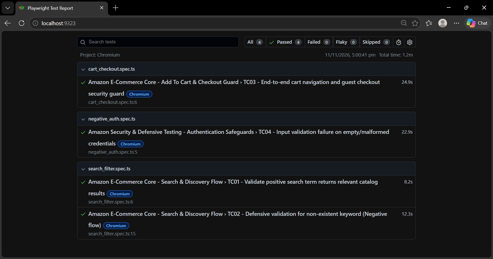

# Amazon E-Commerce End-to-End Test Automation Suite

A robust, production-ready UI & API automation framework built with **Playwright**, **TypeScript**, and the **Page Object Model (POM)** architecture. This suite automates critical user journeys on Amazon, covering catalog discovery, defensive search scenarios, cart security boundaries, and authentication input validations.

---

## 🛠️ Tech Stack

* **Testing Framework:** Playwright
* **Programming Language:** TypeScript
* **Design/Architecture Pattern:** Page Object Model (POM)
* **Testing Approach:** End-to-End (E2E) UI Automation & Defensive Search Validation
* **CI/CD Pipeline:** GitHub Actions

---

## 📌 Project Overview & Architecture

The framework is structured using modular design patterns to decouple test specifications from DOM selectors and underlying page logic.

- **Page Object Model (POM):** UI selectors and user actions are encapsulated inside modular classes under `pages/`, ensuring minimal maintenance overhead when UI locators change.
- **Web-First Assertions:** Utilizes Playwright's built-in auto-waiting assertions (`expect(locator).toBeVisible()`, etc.) to eliminate flakiness and hardcoded timeouts.
- **Defensive Error Handling:** Implements dynamic locator fallbacks and graceful degradation for anti-bot measures, geo-location overlays, and localization barriers.
- **Clean Execution Isolation:** Every test runs in an independent browser context to guarantee zero state leakage across execution cycles.

---

## 📂 Repository Structure

```text
├── pages/
│   ├── HomePage.ts            # Amazon home navigation, search bar interactions & geo-modals
│   ├── SearchResultsPage.ts   # Product catalog parsing, filters, and zero-result state checks
│   ├── ProductPage.ts         # PDP details, add-to-cart operations, and tab handoffs
│   ├── CartPage.ts            # Cart subtotal verification and checkout initiation
│   └── SignInPage.ts          # Authentication boundaries, email inputs & validation alerts
├── tests/
│   ├── search_filter.spec.ts  # TC01 (Positive Search) & TC02 (Negative Search Validation)
│   ├── cart_checkout.spec.ts  # TC03 (Guest Cart & Checkout Authentication Guard)
│   └── negative_auth.spec.ts  # TC04 (Defensive Form Validation & Missing Credentials)
├── playwright.config.ts       # Global test runner settings, timeouts, reporters & base URLs
├── package.json               # Dependencies and execution scripts
├── .gitignore                 # Excludes node_modules, binaries, and local run artifacts
└── README.md                  # Comprehensive framework documentation
```

---

## 🧪 Automated Test Scenarios

| Test ID | Suite | Scenario Description | Expected Outcome |
| :--- | :--- | :--- | :--- |
| **TC01** | `search_filter.spec.ts` | **Catalog Discovery & Keyword Search**<br>Execute search query for a valid item (`wireless mouse`). | Product catalog displays relevant search results and item listings. |
| **TC02** | `search_filter.spec.ts` | **Zero-Result Defensive Validation**<br>Submit random non-existent query (`sdjhfkjsdfhksjdhfksjdfh`). | System gracefully renders "No results for..." empty state without breaking. |
| **TC03** | `cart_checkout.spec.ts` | **Checkout Security Barrier (Auth Guard)**<br>Attempt guest cart navigation and checkout initiation. | Unauthenticated user is intercepted and routed to the secure sign-in wall. |
| **TC04** | `negative_auth.spec.ts` | **Authentication Input Validation**<br>Trigger login submission with empty or malformed fields. | Amazon triggers inline client-side validation alerting missing credentials. |

---

## ⚠️ Production Environment & Bot Mitigation Note

Executing end-to-end checkout and payment automation against a live production environment (like Amazon.com) is heavily guarded by CAPTCHA, 2FA, and OTP challenges. In an enterprise pre-production or staging environment, this is standardly automated using:
1. **Pre-authenticated Session States:** Reusing exported authentication states via `storageState.json`.
2. **OTP Bypass Headers / Test APIs:** Direct programmatic authentication via internal staging endpoints or mock SMS/email APIs.

**Framework Target:** Validates the complete user shopping funnel up to the strict authentication security perimeter.

---

## 🚀 Setup & Execution Guide

### Prerequisites
- Node.js (v18.x or higher)
- npm (v9.x or higher)

### 1. Installation
Clone the repository and install project dependencies alongside Playwright browser binaries:

```bash
# Clone the repository
git clone [https://github.com/AbhiYewale96/amazon-ecommerce-playwright-automation.git](https://github.com/AbhiYewale96/amazon-ecommerce-playwright-automation.git)

# Navigate into the project folder
cd amazon-ecommerce-playwright-automation

# Install npm dependencies
npm install

# Install Playwright browser binaries and OS dependencies
npx playwright install --with-deps
```

### 2. Run All Tests
Execute the entire test suite in headless mode across configured browsers:

```bash
npx playwright test
```

### 3. Run Tests in Interactive / Headed Mode
Watch tests execute live in a visible Chromium browser window:

```bash
npx playwright test --headed
```

### 4. Run Specific Test Suites

**Catalog Search & Zero-Result Scenarios:**
```bash
npx playwright test tests/search_filter.spec.ts
```

**Cart & Checkout Auth Guard:**
```bash
npx playwright test tests/cart_checkout.spec.ts
```

**Negative Form & Input Validation:**
```bash
npx playwright test tests/negative_auth.spec.ts
```

---

## 📊 Viewing Test Reports & Artifacts

After execution completes, launch the interactive HTML report to view execution timelines, error logs, and DOM snapshots:

```bash
npx playwright show-report
```

Below is the generated HTML report after successfully executing the Playwright E2E automation suite. The tests cover both positive user journeys and defensive edge cases:


---
